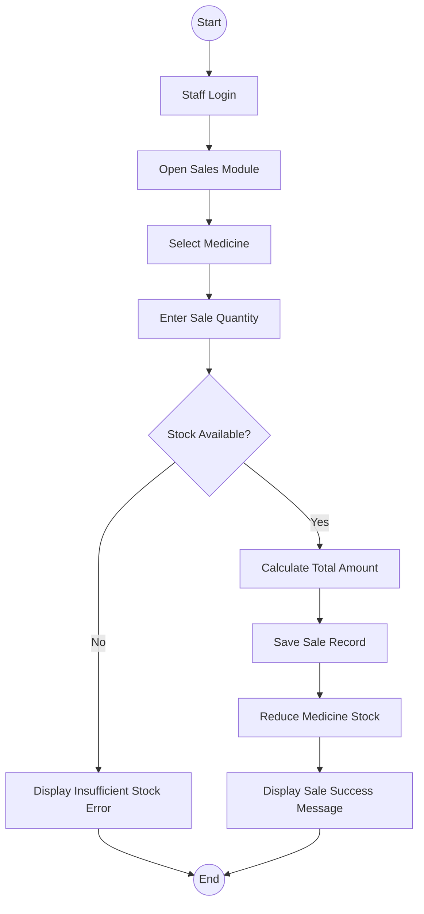

# ACTIVITY DIAGRAM

## 1. Introduction

The Activity Diagram represents the workflow of recording a medicine sale in the Pharmacy Management System. It shows the actions performed by staff and the stock-availability decision made by the system.

## 2. Activity Diagram

## 3. Activities

| Activity | Description |
|---|---|
| Start | Begins the medicine-sales workflow. |
| Staff Login | Staff signs in to access the system. |
| Open Sales Module | Staff navigates to the sales section. |
| Select Medicine | Staff chooses the medicine to sell. |
| Enter Sale Quantity | Staff enters the number of units requested. |
| Stock Available? | System checks whether the requested quantity is available. |
| Insufficient Stock Error | If stock is insufficient, an error is displayed and the sale is not saved. |
| Calculate Total Amount | If stock is sufficient, system calculates quantity multiplied by selling price. |
| Save Sale Record | System records the sale in the database. |
| Reduce Medicine Stock | System deducts the sold quantity from inventory. |
| Display Sale Success Message | System confirms the sale. |
| End | The workflow finishes. |

## 4. Workflow

The staff member logs in, opens the Sales module, selects a medicine, and enters the sale quantity. The system checks the available stock. If stock is insufficient, an error message is displayed. If stock is sufficient, the system calculates the total, saves the sale, reduces medicine stock, and displays a success message.

## 5. Conclusion

The Activity Diagram describes the complete medicine-sales workflow and shows how the system handles both sufficient-stock and insufficient-stock conditions.
