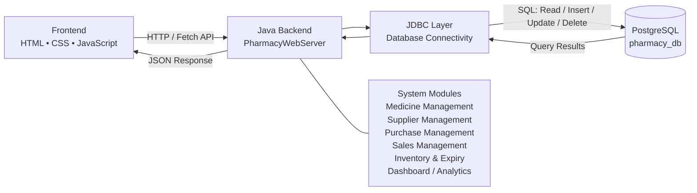

# COMPONENT DIAGRAM

## 1. Introduction

The Component Diagram represents the main software components of the Pharmacy Management System and how they communicate with each other. The frontend interacts with the Java backend through HTTP API requests. The backend uses JDBC to access the PostgreSQL database.

## 2. Component Diagram

## 3. Components

| Component | Description |
|---|---|
| Frontend | Web interface built using HTML, CSS, and JavaScript. Staff use it to interact with the system. |
| Java Backend | `PharmacyWebServer` receives API requests, processes business logic, and sends responses. |
| JDBC Layer | Connects Java to PostgreSQL and executes SQL queries. |
| PostgreSQL Database | Stores medicine, supplier, purchase, and sales data. |
| System Modules | Contains medicine, supplier, purchase, sales, inventory, expiry, and dashboard/analytics functions. |

## 4. Communication

The frontend sends HTTP requests using JavaScript Fetch API. The Java backend handles the request and uses JDBC to communicate with PostgreSQL. The database returns query results, and the backend sends a JSON response to the frontend.

## 5. Conclusion

The Component Diagram gives an overview of the system architecture and shows how the frontend, Java backend, JDBC, and PostgreSQL work together to provide pharmacy management features.
