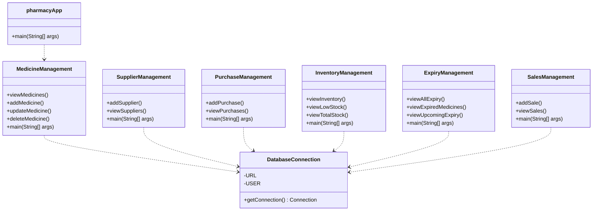

# CLASS DIAGRAM

## 1. Introduction

The Class Diagram represents the structure of the Pharmacy Stock Management and Medicine Sales Analysis System. It shows the main Java classes, their attributes, methods, and relationships.

## 2. Class Diagram

## 3. Class Descriptions

### 3.1 pharmacyApp
Provides the main application entry point.

### 3.2 DatabaseConnection
Establishes a connection between Java and PostgreSQL using JDBC.

### 3.3 MedicineManagement
Handles adding, viewing, updating, and deleting medicine records.

### 3.4 SupplierManagement
Manages supplier information.

### 3.5 PurchaseManagement
Records purchases and updates medicine stock.

### 3.6 InventoryManagement
Displays available stock, low-stock medicines, and total stock.

### 3.7 ExpiryManagement
Checks medicine expiry dates and identifies expired or upcoming-expiry medicines.

### 3.8 SalesManagement
Records sales, checks available stock, updates inventory, and displays sales records.

## 4. Conclusion

The Class Diagram illustrates the modular design of the Java application. Each management class performs a specific task and uses DatabaseConnection to access PostgreSQL.