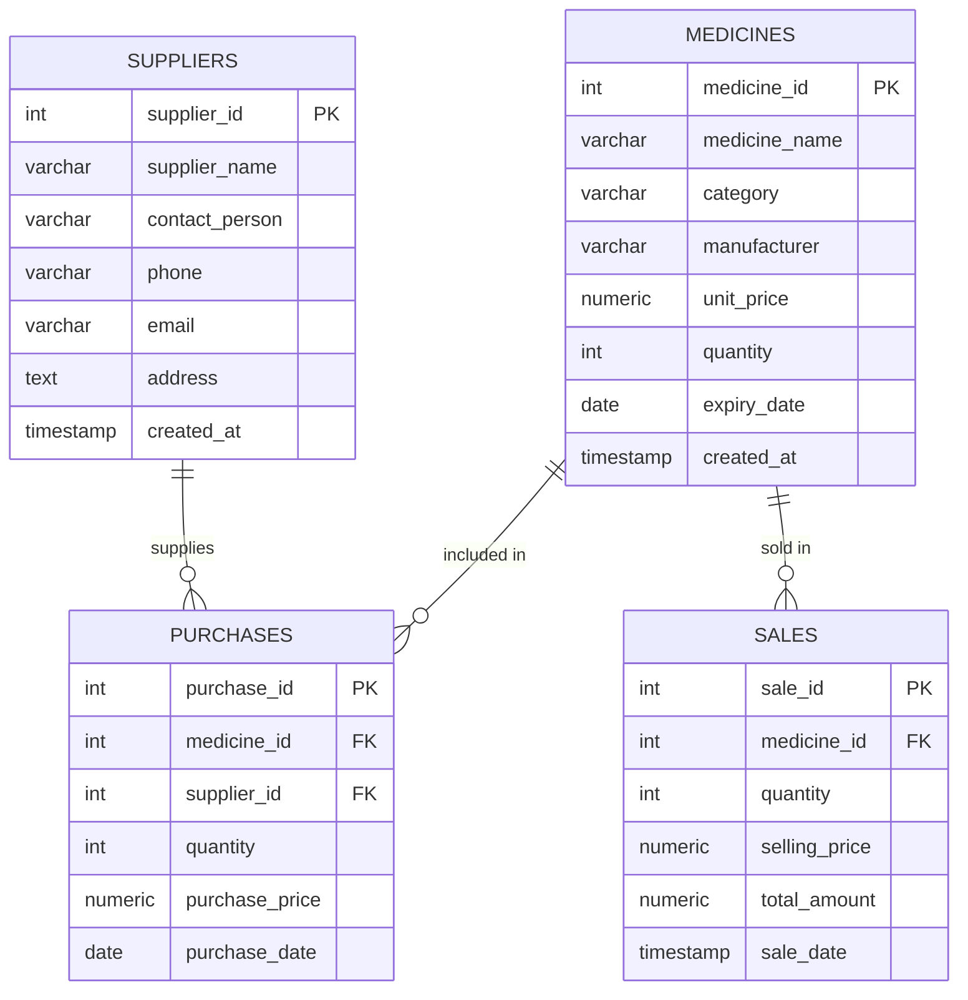

# DATABASE ER DIAGRAM

## 1. Introduction

The Entity-Relationship Diagram represents the database structure of the Pharmacy Stock Management and Medicine Sales Analysis System. It shows the tables, primary keys, foreign keys, and relationships.

## 2. ER Diagram

## 3. Database Relationships

1. **Medicines and Purchases:** One medicine can appear in multiple purchase records.
2. **Suppliers and Purchases:** One supplier can have multiple purchase records.
3. **Medicines and Sales:** One medicine can appear in multiple sales records.

## 4. Primary Keys and Foreign Keys

- `medicine_id` – Primary key in the medicines table.
- `supplier_id` – Primary key in the suppliers table.
- `purchase_id` – Primary key in the purchases table.
- `sale_id` – Primary key in the sales table.
- `medicine_id` in purchases and sales – Foreign key referencing medicines.
- `supplier_id` in purchases – Foreign key referencing suppliers.

## 5. Conclusion

The ER Diagram shows how the four PostgreSQL tables are connected. Primary keys and foreign keys maintain relationships and data consistency in the pharmacy database.