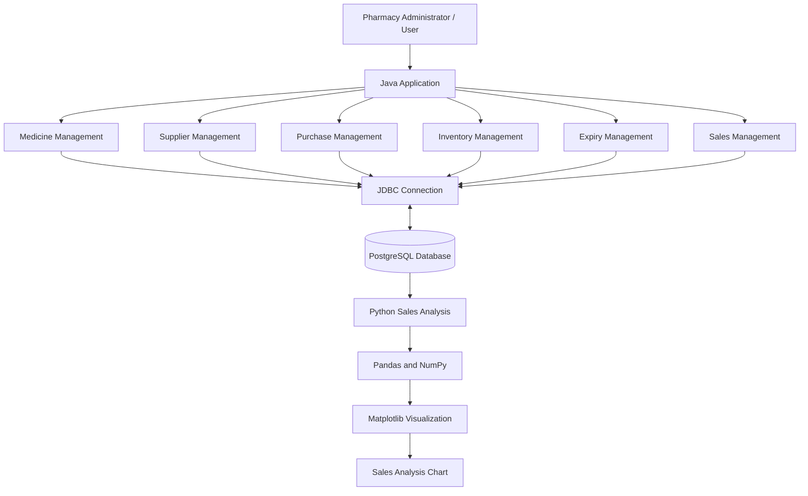

# SYSTEM ARCHITECTURE DIAGRAM

## 1. Architecture Overview

The Pharmacy Stock Management and Medicine Sales Analysis System follows a three-layer architecture.

### 2. Architecture Diagram

## 3. Architecture Components

### Presentation Layer
The Java menu-driven application allows users to manage medicines, suppliers, purchases, inventory, expiry dates, and sales.

### Application Layer
Java classes implement business logic, validation, stock updates, and database operations.

### Database Layer
PostgreSQL stores medicine, supplier, purchase, and sales information.

### Data Analysis Layer
Python retrieves actual sales data from PostgreSQL. Pandas and NumPy perform calculations, while Matplotlib generates graphical reports.

## 4. Data Flow

1. The user selects an operation in the Java application.
2. Java processes the request.
3. JDBC communicates with PostgreSQL.
4. PostgreSQL stores or retrieves the required information.
5. Python retrieves sales records for analysis.
6. Pandas and NumPy calculate sales statistics.
7. Matplotlib generates the sales analysis chart.

## 5. Conclusion

The architecture separates application logic, database storage, and sales analysis, making the system easier to maintain and extend.