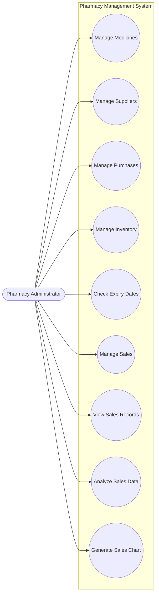

# USE CASE DIAGRAM

## 1. Introduction

The Use Case Diagram represents the interactions between the Pharmacy Administrator and the Pharmacy Stock Management and Medicine Sales Analysis System.

## 2. Use Case Diagram

## 3. Actors

### Primary Actor
**Pharmacy Administrator:** The main user who operates the application and manages pharmacy information.

## 4. Use Cases

| Use Case | Description |
|---|---|
| Manage Medicines | Add, view, update, and delete medicine records |
| Manage Suppliers | Add and view supplier information |
| Manage Purchases | Record and view medicine purchases |
| Manage Inventory | View stock, low-stock medicines, and total stock |
| Check Expiry Dates | View expired and upcoming-expiry medicines |
| Manage Sales | Record medicine sales and update stock |
| View Sales Records | Display stored sales transactions |
| Analyze Sales Data | Calculate sales statistics using Python |
| Generate Sales Chart | Display graphical sales analysis |

## 5. Conclusion

The Use Case Diagram explains the main functions available to the pharmacy administrator and provides an overview of the system's capabilities.